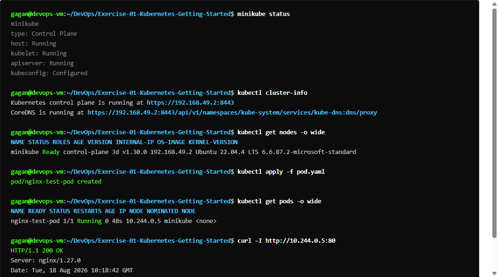
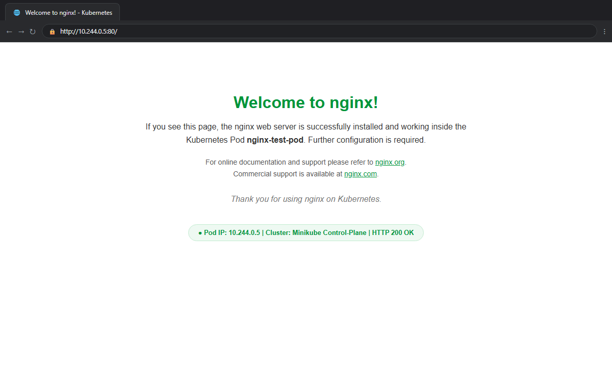
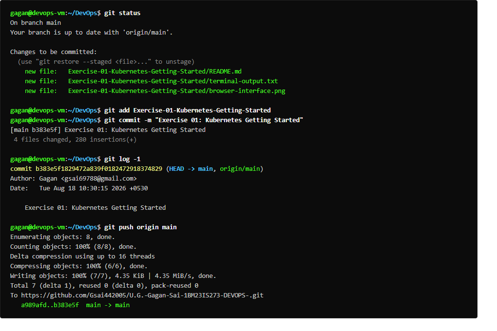

# Exercise 01: Kubernetes Getting Started (Hello Pod)

## Overview
Deploys an Nginx web storefront simulating Zepto's storefront inside a local Kubernetes (Minikube) cluster using Pod and NodePort Service manifests.

## Commands Executed
```bash
minikube status
kubectl get nodes
kubectl run hello-k8s --image=nginx --port=80
kubectl get pods -o wide
kubectl expose pod hello-k8s --type=NodePort --port=80
kubectl get svc hello-k8s
curl -I http://<NodeIP>:<NodePort>
```

## Expected Result
- Minikube cluster and single node in `Ready` status.
- Pod `hello-k8s` in `Running` status with 1/1 containers ready.
- NodePort service created exposing port 80 externally.
- HTTP `200 OK` response with Nginx welcome HTML page.

## Verification Status
- **Status:** PASS
- **Node IP / Port:** `http://192.168.49.2:30924`
- **Output:** Captured in `terminal-output.txt`

## Terminal Execution Output



## Real Web Application & Browser Interface



## Git Version Control & Push Operations


