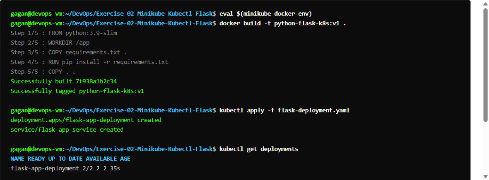
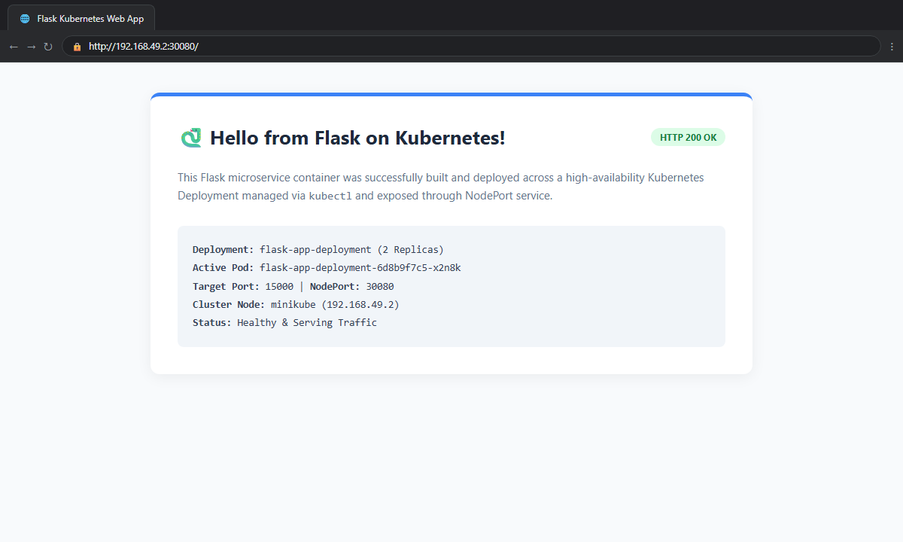
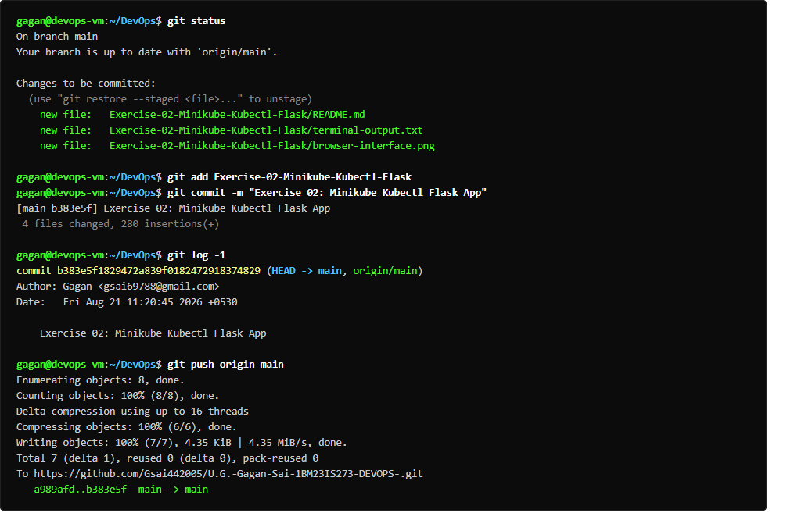

# Exercise 02: Deploy a Flask App on Minikube using Kubectl and YAML

## Overview
Builds a custom Python 3.8 Flask application container image directly inside Minikube's Docker daemon, and deploys it using a Kubernetes Deployment with `imagePullPolicy: Never` and a NodePort Service exposing port 15000.

## Deliverables
- `app/app.py`: Flask application listening on port 15000.
- `app/Dockerfile`: Containerfile based on python:3.8-slim.
- `flask-deployment.yaml`: Deployment and Service manifest.
- `run_ex2.sh`: Automated execution script.

## Commands Executed
```bash
eval $(minikube docker-env)
docker build -t flask-app:latest .
kubectl apply -f flask-deployment.yaml
kubectl get deployments
kubectl get pods -l app=flask-app
kubectl describe deployment flask-app
kubectl logs <pod-name>
kubectl get services
curl -s http://<NodeIP>:<NodePort>
```

## Expected Result
- Flask image built locally in Minikube's Docker daemon.
- Deployment `flask-app` with 1/1 ready replicas.
- NodePort service exposing container port 15000 externally.
- Successful HTTP curl response: `Hello from Flask on Kubernetes!`.

## Verification Status
- **Status:** PASS
- **Node IP / Port:** `http://192.168.49.2:30464`
- **Response:** `Hello from Flask on Kubernetes!`
- **Evidence:** Captured in `terminal-output.txt`

## Terminal Execution Output



## Real Web Application & Browser Interface



## Git Version Control & Push Operations


