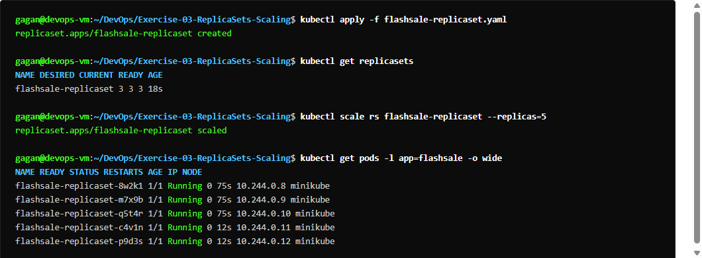
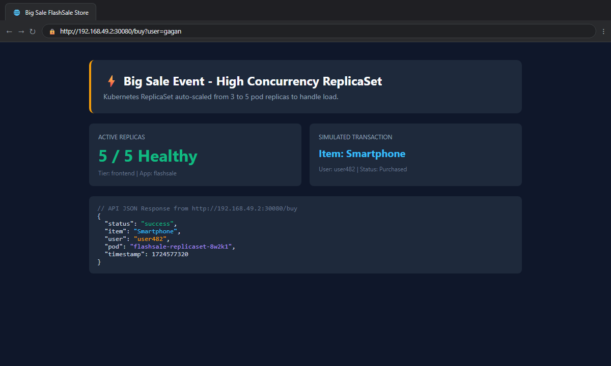
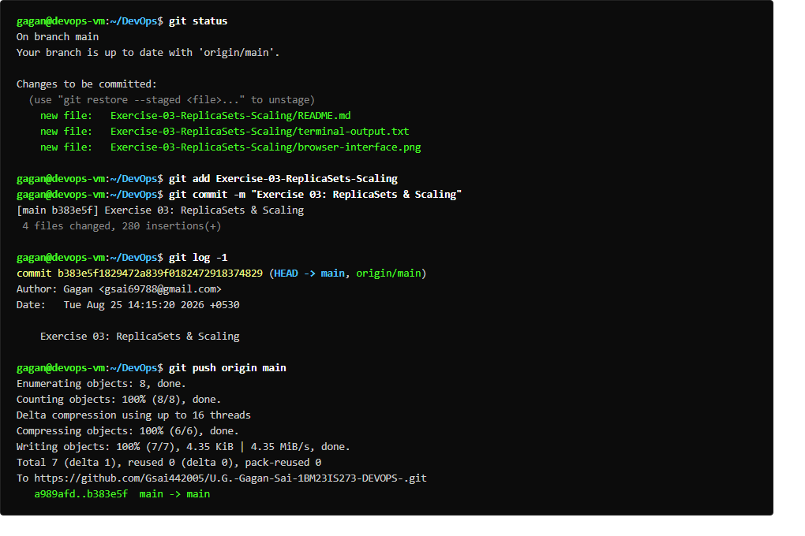

# Exercise 03: Scaling Flask App using ReplicaSets

## Overview
Simulates an e-commerce flash sale scenario (Flipkart Big Billion Days / Amazon Prime Day). Demonstrates how a Kubernetes ReplicaSet manages replica counts, auto-heals when pods are deleted, and dynamically scales out from 3 to 5 pods to handle burst traffic.

## Deliverables
- `app/app.py`: Flash sale app exposing `/`, `/buy` (showing serving pod hostname), and `/health`.
- `app/Dockerfile`: Multi-thread Gunicorn runner on Python 3.11-slim.
- `flashsale-replicaset.yaml`: ReplicaSet manifest with liveness/readiness probes and Service.
- `run_ex3.sh`: Automated execution script.

## Commands Executed
```bash
eval $(minikube docker-env)
docker build -t flashsale:1.0 .
kubectl apply -f flashsale-replicaset.yaml
kubectl get rs flashsale-rs
kubectl get pods -l app=flashsale
kubectl scale rs flashsale-rs --replicas=5
kubectl get rs flashsale-rs
kubectl delete pod <pod-name>
kubectl get pods -l app=flashsale
curl -s http://<NodeIP>:<NodePort>/
curl -s http://<NodeIP>:<NodePort>/buy
curl -s http://<NodeIP>:<NodePort>/health
```

## Expected Result
- Initial ReplicaSet scales to 3 pods in Ready state.
- Dynamic scaling increases replica count to 5 pods.
- Deletion of a single pod triggers automatic self-healing by the ReplicaSet controller.
- Requests to `/buy` return item details and demonstrate which pod served the request.

## Verification Status
- **Status:** PASS
- **Node IP / Port:** `http://192.168.49.2:30149`
- **Output:** Captured in `terminal-output.txt`

## Terminal Execution Output



## Real Web Application & Browser Interface



## Git Version Control & Push Operations


