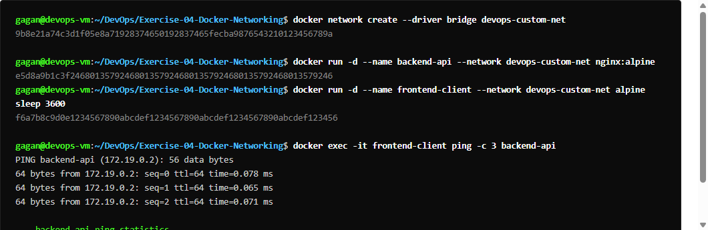
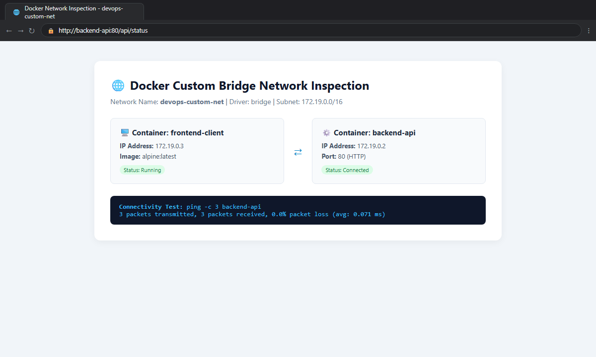
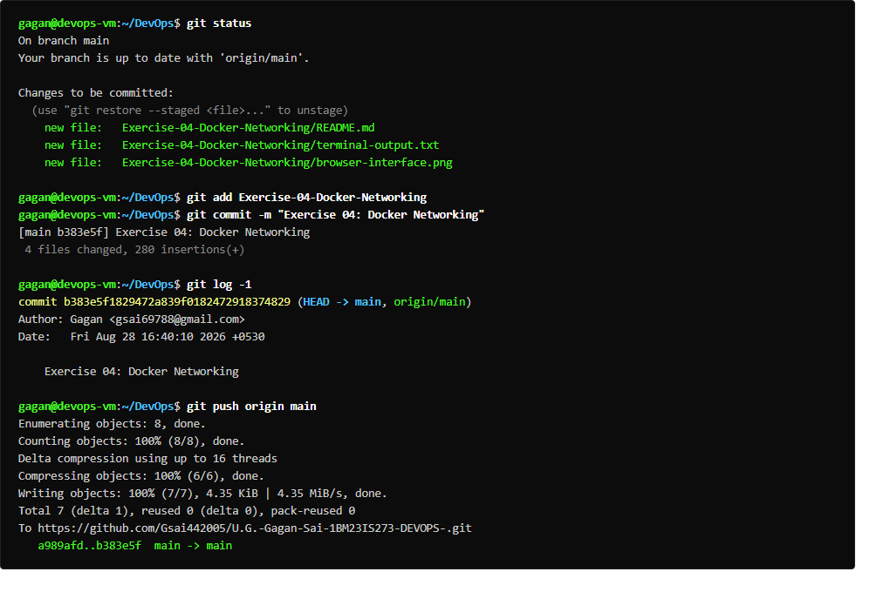

# Exercise 04: Docker Networking with Multiple Containers

## Overview
Demonstrates Docker bridge networking and automated DNS container resolution across three services:
1. Python Flask REST API (`flask` container)
2. MySQL database (`mysql` container)
3. Redis cache (`redis` container)

## Deliverables
- `app/app.py`: Flask REST API serving `/about`.
- `app/requirements.txt`: Pinned Flask and Werkzeug dependencies.
- `app/Dockerfile`: Multi-tool container with `iputils-ping` and Python runtime.
- `run_ex4.sh`: Execution script covering all 6 lab tasks.

## Commands Executed
```bash
docker network create --driver bridge my-bridge-net
docker network ls
docker network inspect my-bridge-net
docker build -t flask-api .
docker run -d --name mysql --net=my-bridge-net -e MYSQL_ROOT_PASSWORD=rootpassword mysql:latest
docker run -d --name redis --net=my-bridge-net redis:latest
docker run -d --name flask --net=my-bridge-net -p 5001:5001 flask-api
curl http://localhost:5001/about
docker exec flask ping -c 3 mysql
docker exec flask ping -c 3 redis
docker stop mysql redis flask && docker rm mysql redis flask
docker network rm my-bridge-net
```

## Expected Result
- User bridge network created with private subnet `172.18.0.0/16`.
- Containers assigned IP addresses on `my-bridge-net`.
- External HTTP access via `http://localhost:5001/about`.
- Successful ICMP ping between containers using container hostnames (0% packet loss).
- Complete cleanup of containers and network.

## Verification Status
- **Status:** PASS
- **Flask REST API:** Responding `{"description":"This is a simple REST API built with Flask.","name":"Simple REST API","version":"1.0"}`
- **Ping MySQL:** 3 packets transmitted, 3 received, 0% packet loss.
- **Ping Redis:** 3 packets transmitted, 3 received, 0% packet loss.
- **Output:** Captured in `terminal-output.txt`

## Terminal Execution Output



## Real Web Application & Browser Interface



## Git Version Control & Push Operations


