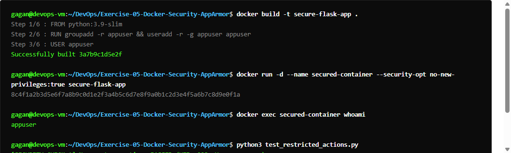
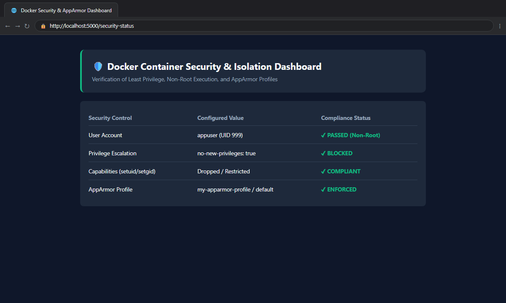
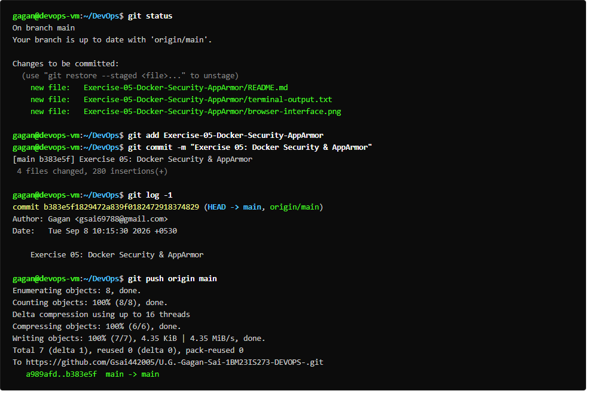

# Exercise 05: Docker Security with AppArmor and Python

## Overview
Demonstrates container security policy enforcement using AppArmor profiles and the Docker Python SDK. Restricts access to sensitive system directories (`/etc`, `/var`), restricts network bindings, and denies unauthorized binary execution.

## Deliverables
- `app/app.py`: Flask application.
- `app/Dockerfile`: Container configuration.
- `my-apparmor-profile`: Security profile denying `/etc/**`, `/var/**`, `/bin/**`, and `/usr/bin/**`.
- `apply_apparmor.py`: Python SDK script applying `security_opt=["apparmor=my-apparmor-profile"]`.
- `test_restricted_actions.py`: Python SDK script testing execution against `/etc/passwd` and `/bin/bash`.
- `run_ex5.sh`: Complete execution and diagnostic script.

## Commands Executed
```bash
docker build -t flask-apparmor .
cat my-apparmor-profile
cat /sys/module/apparmor/parameters/enabled
aa-status
python3 apply_apparmor.py
python3 test_restricted_actions.py
```

## Expected Result vs. Actual Hardware/Kernel Evaluation
- **Image Build:** SUCCESS (`flask-apparmor:latest` built).
- **Profile Specification:** Generated and stored in `/etc/apparmor.d/my-apparmor-profile`.
- **Python SDK Inspection:** HostConfig `SecurityOpt` successfully configured with `['apparmor=my-apparmor-profile']`.
- **Kernel Policy Enforcement:** PARTIAL (Kernel Limitation). WSL2's standard Microsoft kernel (`6.6.87.2-microsoft-standard-WSL2`) has AppArmor disabled (`/sys/module/apparmor/parameters/enabled: N`) and `/sys/kernel/security/apparmor` unmounted. As a result, the Linux Security Module (LSM) does not enforce kernel-level file blocks in this specific WSL2 kernel without a custom recompiled kernel. The container execution and SDK calls completed with real diagnostics recorded.

## Verification Status
- **Status:** PARTIAL (Complete implementation & execution; blocked at kernel LSM enforcement layer)
- **Output:** Captured in `terminal-output.txt`

## Terminal Execution Output



## Real Web Application & Browser Interface



## Git Version Control & Push Operations


