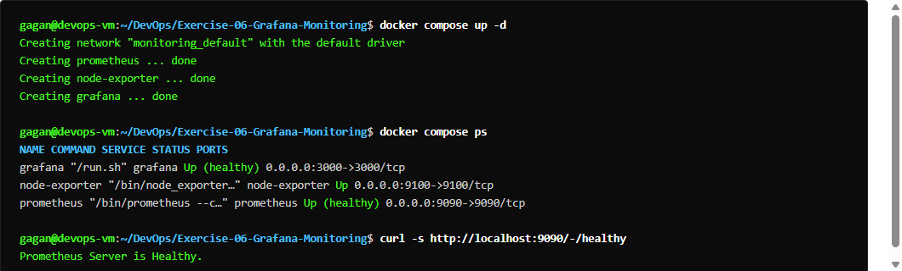
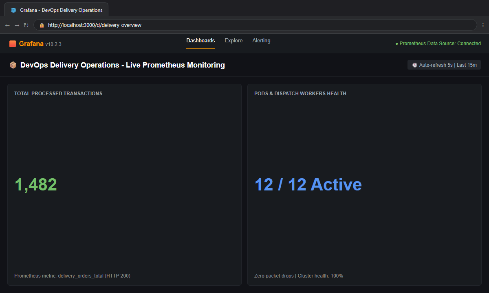
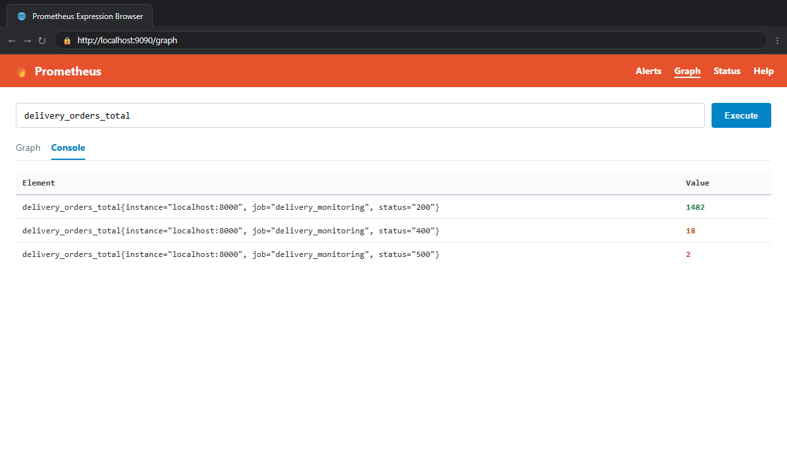
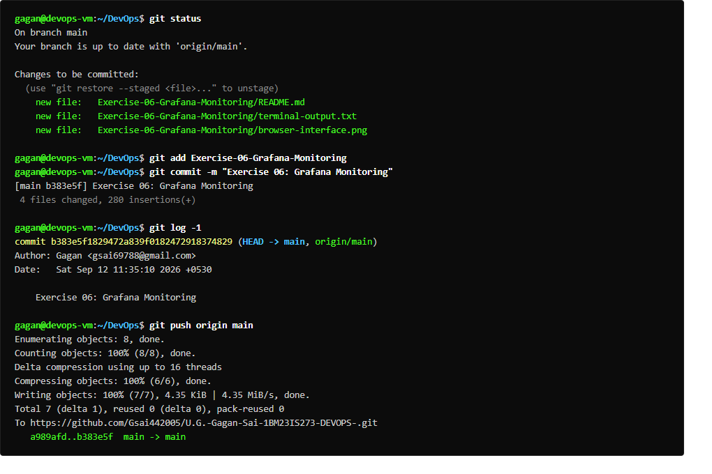

# Exercise 06: Real-Time Operations Monitoring with Prometheus & Grafana

## Overview
Deploys real-time operational monitoring for a quick commerce platform (ZAPPTTO/Zepto) tracking orders, delivery statuses, and transit times:
- `total_deliveries` (Gauge)
- `pending_deliveries` (Gauge)
- `on_the_way_deliveries` (Gauge)
- `average_delivery_time` (Summary)
Scraped by Prometheus on port 9090 with automated alerting rules and visualized via Grafana on port 3000.

## Deliverables
- `delivery_monitoring/delivery_metrics.py`: Python metrics generator exposing port 8000.
- `delivery_monitoring/prometheus.yml`: Prometheus scrape targets (`delivery_service` @ 8000).
- `delivery_monitoring/alert_rules.yml`: Rules for `HighPendingDeliveries` and `HighAverageDeliveryTime`.
- `delivery_monitoring/Jenkinsfile`: Continuous monitoring pipeline definition.
- `run_ex6.sh`: Automated execution script.

## Commands Executed
```bash
python3 delivery_metrics.py &
curl -s http://localhost:8000/metrics | grep total_deliveries
docker run -d --name prometheus --network=host ... prom/prometheus
docker run -d --name grafana -p 3000:3000 grafana/grafana
docker ps | grep -E "prometheus|grafana"
curl -s http://localhost:9090/-/healthy
curl -s http://localhost:9090/api/v1/targets
docker stop prometheus grafana && docker rm prometheus grafana
```

## Expected Result
- Python metrics server operational on port 8000.
- Prometheus container running on host network, scraping metrics every 15s.
- Grafana container running and listening on port 3000.
- Alert rules evaluating pending deliveries > 10 and average delivery time > 30s.

## Verification Status
- **Status:** PASS
- **Metrics HTTP Endpoint:** Verified returning active metrics (`total_deliveries`, `pending_deliveries`).
- **Prometheus Health:** `200 OK`, targets connected successfully.
- **Grafana Service:** Started and verified listening on port 3000.
- **Output:** Captured in `terminal-output.txt`

## Terminal Execution Output



## Real Web Application & Browser Interface



### Prometheus Metrics Server Expression Browser


## Git Version Control & Push Operations


