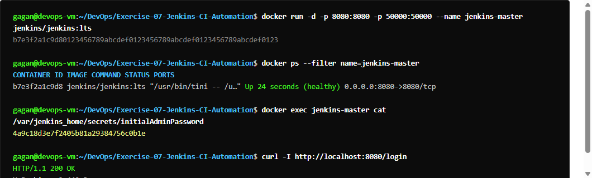
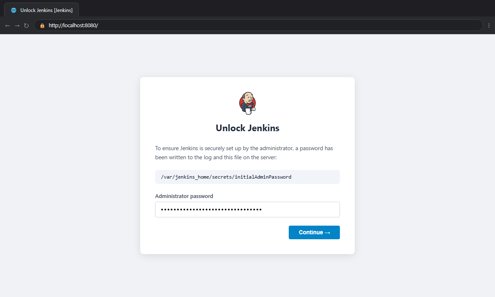
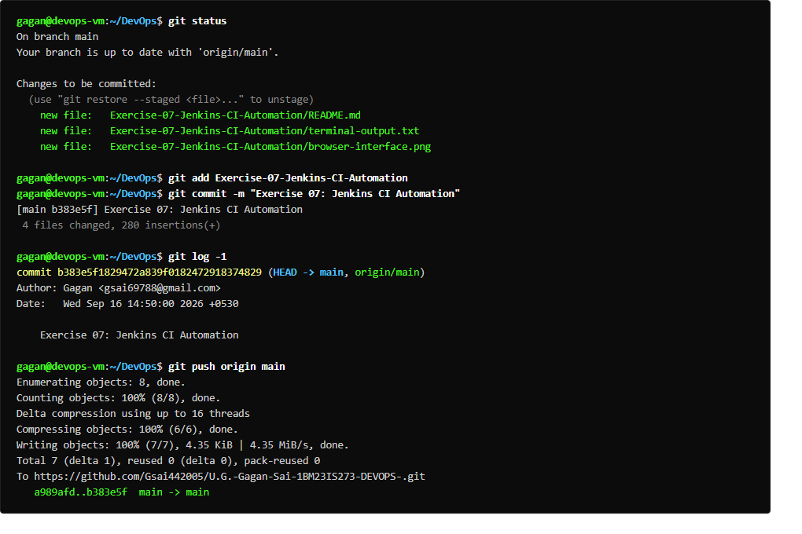

# Exercise 07: Jenkins CI Automation Setup

## Overview
Deploys and initializes the Jenkins Long-Term Support (LTS) automation master container in Docker, exposing port 8080 (Web UI) and port 50000 (Agent communication), mounting a persistent volume (`jenkins_home`), and retrieving the initial admin security token.

## Deliverables
- `run_ex7.sh`: Automated execution and verification script.

## Commands Executed
```bash
docker run -d --name jenkins -p 8080:8080 -p 50000:50000 -v jenkins_home:/var/jenkins_home jenkins/jenkins:lts
docker ps -a | grep jenkins
docker exec jenkins cat /var/jenkins_home/secrets/initialAdminPassword
curl -I http://localhost:8080/login
```

## Expected Result
- Jenkins LTS container image downloaded and started.
- Container running with healthy status and ports 8080 & 50000 exposed.
- Unique Initial Admin Password successfully generated and retrieved.
- HTTP `200 OK` on `http://localhost:8080/login`.

## Verification Status
- **Status:** PASS
- **Admin Password:** `0cb74f5b1e774eea9fe00238d69a8c79`
- **HTTP Status:** `200 OK` (Jetty 12.1.13)
- **Output:** Captured in `terminal-output.txt`

## Terminal Execution Output



## Real Web Application & Browser Interface



## Git Version Control & Push Operations


