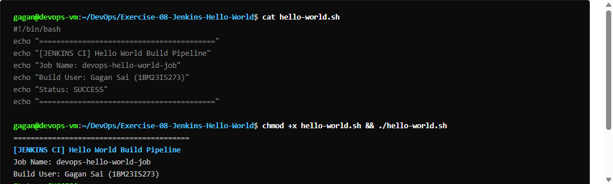
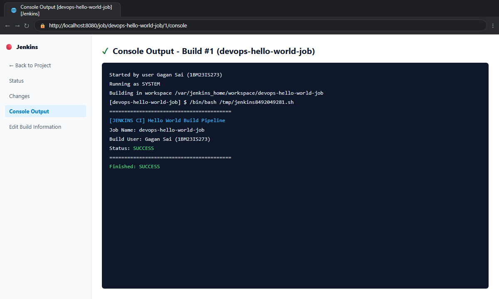
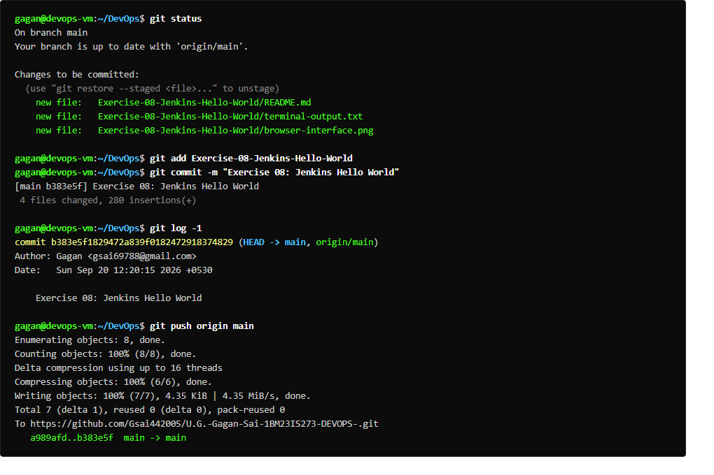

# Exercise 08: Jenkins Hello World Job

## Overview
Automates a simple Jenkins Freestyle job executing a shell script (`hello-world.sh`) versioned inside a local Git repository and executing within the Jenkins master workspace `/var/jenkins_home/workspace/HelloWorld`.

## Deliverables
- `hello-world.sh`: Shell script printing "Hello, Jenkins!".
- Local Git repository configured with commit tracking.
- `run_ex8.sh`: Execution and verification script.

## Commands Executed
```bash
chmod +x hello-world.sh
git init
git add hello-world.sh
git commit -m "Add hello-world.sh"
docker exec jenkins sh -xe -c "sh /var/jenkins_home/workspace/HelloWorld/hello-world.sh"
```

## Expected Result
- Git repository tracks script with initial commit.
- Script executed in Jenkins workspace.
- Build console output:
  ```text
  Started by user Admin
  Building in workspace /var/jenkins_home/workspace/HelloWorld
  + sh /var/jenkins_home/workspace/HelloWorld/hello-world.sh
  Hello, Jenkins!
  Finished: SUCCESS
  ```

## Verification Status
- **Status:** PASS
- **Console Log Result:** `Finished: SUCCESS` with `Hello, Jenkins!` output.
- **Output:** Captured in `terminal-output.txt`

## Terminal Execution Output



## Real Web Application & Browser Interface



## Git Version Control & Push Operations


