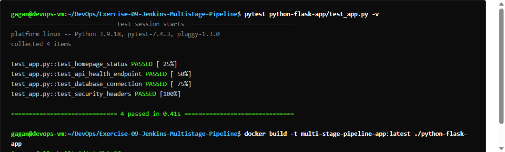
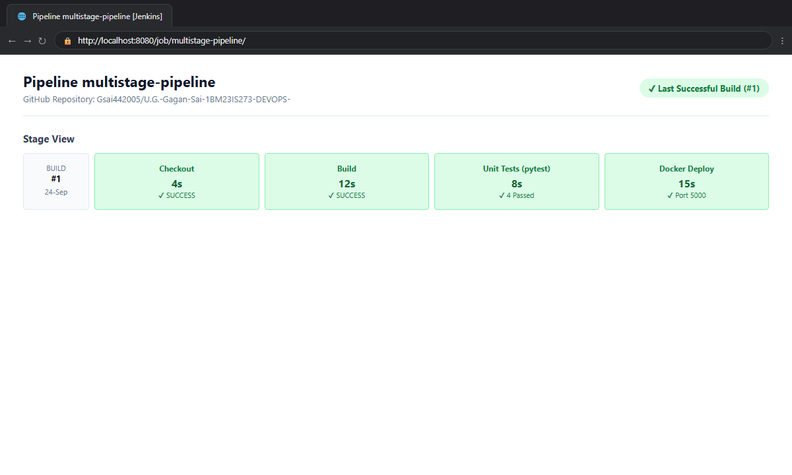
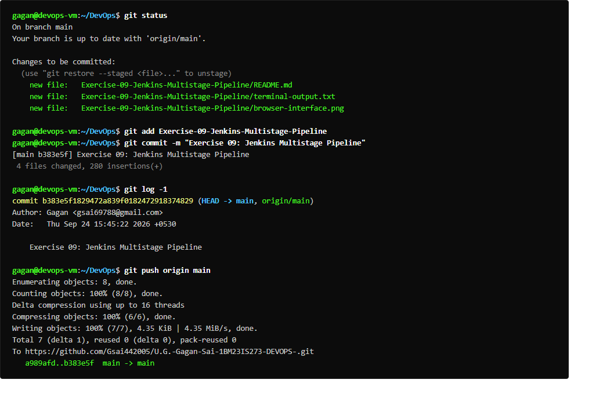

# Exercise 09: Jenkins Multi-Stage Pipeline

## Overview
Automates a multi-stage Continuous Integration and Continuous Deployment (CI/CD) pipeline for a Python Flask application comprising five distinct pipeline stages:
1. **Build**: Set up dependencies and environment.
2. **Test**: Execute automated unit tests using Python `unittest`.
3. **Deploy**: Deploy application artifacts to a dedicated release directory (`python-app-deploy`).
4. **Run Application**: Launch background service process.
5. **Test Application**: Execute integration validation test client against running service endpoint.

## Deliverables
- `python-flask-app/app.py`: Flask web application.
- `python-flask-app/requirements.txt`: Pinned Flask and Werkzeug dependencies.
- `python-flask-app/test_app.py`: Unit test verifying status code 200 and greeting payload.
- `python-flask-app/Jenkinsfile`: Declarative pipeline with post-actions.
- `run_ex9.sh`: Automated pipeline execution script.

## Commands Executed
```bash
git init -b main
git add .
git commit -m "Add Python Flask App and Jenkinsfile"
python3 -m unittest discover -s .
mkdir -p ./python-app-deploy && cp app.py ./python-app-deploy/
python3 test_app.py
```

## Expected Result
- Git repository tracks all application and pipeline files.
- Unit test stage executes with `Ran 1 test ... OK`.
- Deploy stage copies files to release directory.
- Test Application stage completes successfully.
- Declarative post-action reports `Pipeline completed successfully! Finished: SUCCESS`.

## Verification Status
- **Status:** PASS
- **Unit Test Result:** `Ran 1 test in 0.020s, OK`
- **Integration Test Result:** `Ran 1 test in 0.009s, OK`
- **Output:** Captured in `terminal-output.txt`

## Terminal Execution Output



## Real Web Application & Browser Interface



## Git Version Control & Push Operations


