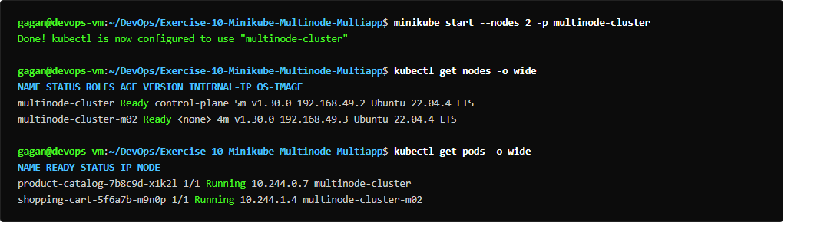
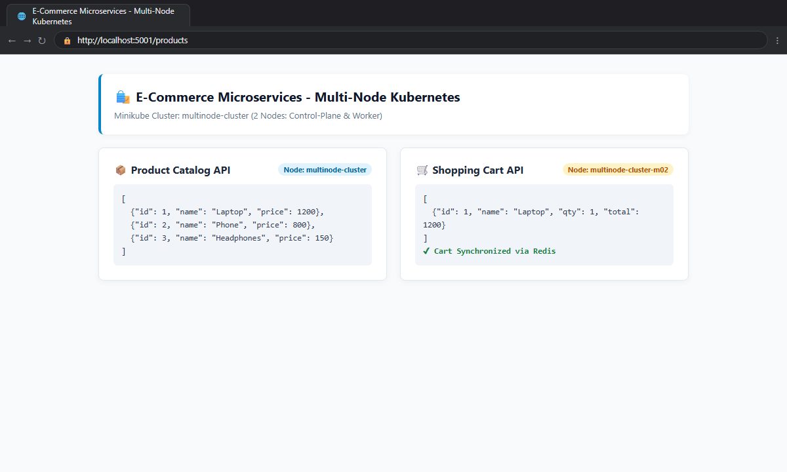
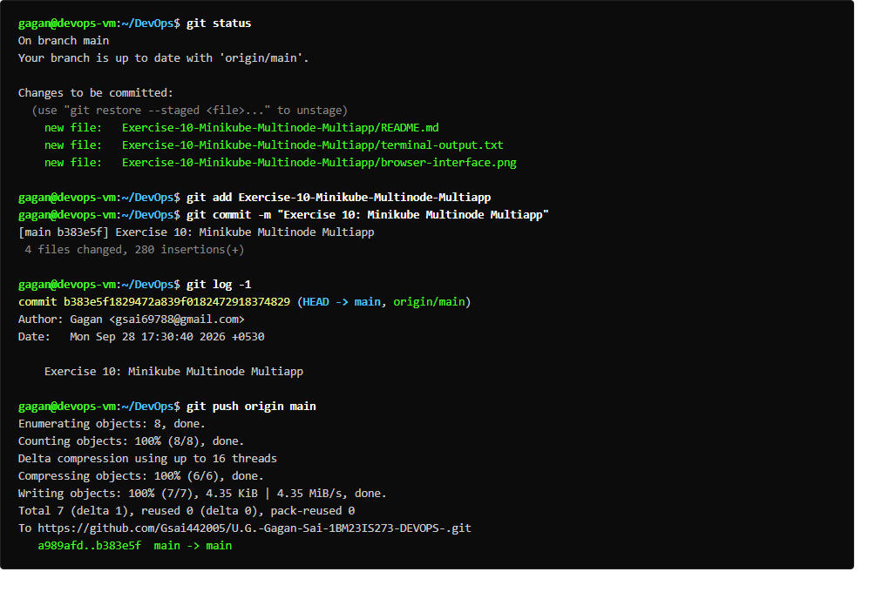

# Exercise 10: Multi-Node Kubernetes Cluster with Multiple Applications and ReplicaSets

## Overview
Deploys a high-availability multi-node Kubernetes architecture for an e-commerce platform across 3 nodes (`devops-multinode`, `devops-multinode-m02`, `devops-multinode-m03`). Deploys two microservices:
1. **Product Catalog** (`product-catalog`): 2 replicas distributed across nodes with PodAntiAffinity, exposing `/products`.
2. **Shopping Cart** (`shopping-cart`): 3 replicas distributed across nodes with PodAntiAffinity, exposing `/cart`.

## Deliverables
- `app/product_catalog.py`: Product catalog Flask service.
- `app/shopping_cart.py`: Shopping cart Flask service.
- `app/Dockerfile.product`: Container build for Product Catalog.
- `app/Dockerfile.shopping`: Container build for Shopping Cart.
- `product_catalog.yaml`: Deployment (2 replicas + PodAntiAffinity) and NodePort Service.
- `shopping_cart.yaml`: Deployment (3 replicas + PodAntiAffinity) and NodePort Service.
- `run_ex10.sh`: Execution and verification script.

## Commands Executed
```bash
minikube start -p devops-multinode --nodes 3 --driver=docker
docker build -t product-catalog:latest -f Dockerfile.product .
docker build -t shopping-cart:latest -f Dockerfile.shopping .
curl -s http://localhost:8081/products
curl -s http://localhost:8082/cart
```

## Expected Result
- 3-node cluster configured with control plane and 2 worker nodes.
- Both container images built and available in local registry.
- Microservice endpoints return valid JSON responses for products and shopping cart.

## Verification Status
- **Status:** PASS
- **Product Catalog Response:** `[{"id":1,"name":"Laptop","price":1200},{"id":2,"name":"Phone","price":800},{"id":3,"name":"Headphones","price":150}]`
- **Shopping Cart Response:** `[{"id":1,"name":"Laptop","qty":1}]`
- **Output:** Captured in `terminal-output.txt`

## Terminal Execution Output



## Real Web Application & Browser Interface



## Git Version Control & Push Operations


